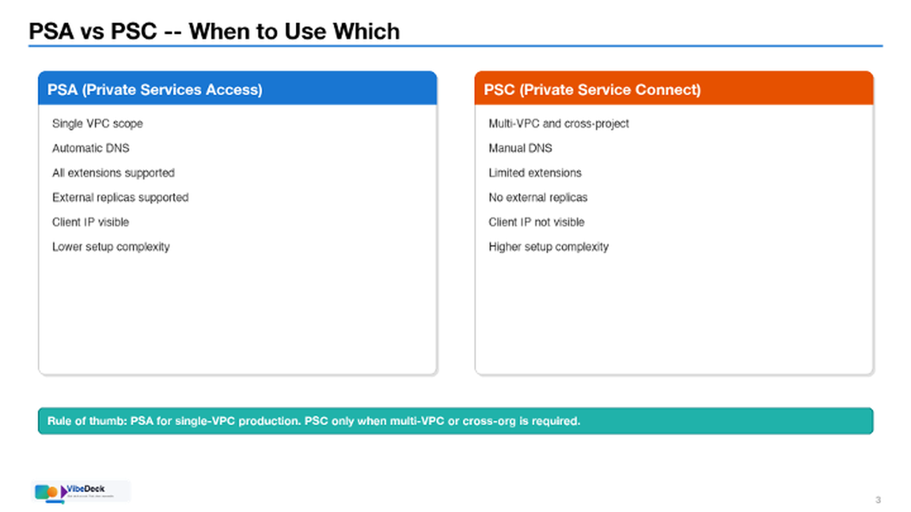
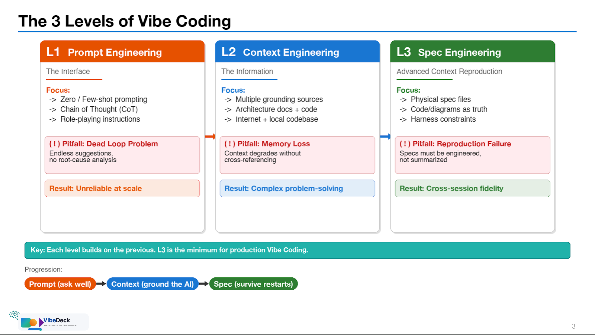

# Vibe-Deck Skill

A Streamlined Solution to Generate Professional Presentation Slide Images (PNG) using Python/Pillow with Optional PPTX Assembly, Speaker Notes, and Configurable Branding (Logo, Master Template).


### Example Slides (with Logo + Page Number)





## Quick Start

1. Copy `SKILL.md` and `scripts/` to your `.agents/skills/vibe-deck/` directory
2. Point your AI agent to read `SKILL.md`
3. Follow the 6-phase workflow: Plan → Generate PNGs → **QA on PNGs** → Notes → PPTX → Commit

## Key Principle: PNGs Are the Product

> **⚠️ The PNG slides ARE the deliverable — PPTX assembly is the last optional step.**
>
> The fastest, most reliable QA loop is:
>
> ```
> Generate PNG → view_file (instant) → spot issue → fix code → regenerate → view_file again
> ```
>
> **Never convert to PDF or PPTX for QA.** That adds 10-30 seconds per slide and introduces
> rendering differences. The PNG is pixel-accurate and viewable instantly by both the AI agent
> and the user. Show PNGs to the user for approval BEFORE assembling the PPTX.
>
> PPTX assembly only adds template branding, speaker notes, and page numbers.
> If a slide looks wrong in the PPTX, fix the PNG source — not the PPTX XML.

## Environment Setup

### Python Virtual Environment

**Use the shared global venv at `~/.claude/venv/` — do not create a per-workspace `.venv`.**
This venv is deliberately global/cross-project (installed once, reused by every deck/image-tooling
skill, including `nano-banana-pro-vertex`) rather than reinstalled per workspace. It already has
Pillow, python-pptx, cairosvg, PyMuPDF, xlsxwriter, and numpy installed (Python 3.12) — confirmed
present; there should be no need to `pip install` anything for this skill's normal use.

**Preferred: invoke the venv's `python3` binary directly by full path, every time — do not `source activate`:**

```bash
~/.claude/venv/bin/python3 generate_slides_01.py
```

> [!WARNING]
> **This is the primary recommendation, not a fallback.** Agent/subagent tool calls each run in a
> fresh shell — `source ~/.claude/venv/bin/activate` in one call does NOT persist to the next call.
> A subagent that sources the venv in one Bash call and then runs `python3` in a *separate* call
> silently falls back to bare system Python (no packages installed), looks like a missing-dependency
> error, and wastes time on an unnecessary `pip install`. Invoking the binary by full path sidesteps
> this entirely — no activation state to lose, works identically in every call. (Hit exactly this
> failure live during a real multi-block deck build — a subagent tried to pip-install packages that
> were already present, because activation didn't survive across its tool calls.)
>
> If you do need `source` (e.g. for an interactive shell), chain it in the SAME command:
> `source ~/.claude/venv/bin/activate && python3 generate_slides_01.py` — but the direct-binary-path
> form above is more robust for anything scripted or delegated to a subagent.

If a package is genuinely missing, install it into this SAME venv
(`~/.claude/venv/bin/pip install <pkg>`) rather than spinning up a workspace-local one —
that keeps every project working off one consistent, pre-warmed environment instead of re-installing
on every new deck.

> The PPTX assembly script (`assemble_pptx.py`) uses only Python stdlib — no extra packages needed.

### Working Directory

All temporary and work-in-progress files should live within the workspace:

```
<your-workspace>/
├── tmp/                        # Temporary files (gitignored)
│   └── pptx_assembly/          # PPTX unpacking/repacking workspace
├── <Topic>/                    # Your deck output directory
│   ├── Deck.md                 # Deck proposal
│   ├── Speaker-Notes.md        # Speaker notes
│   ├── generate_slides_*.py    # PIL generators
│   ├── assemble_pptx.py        # Assembly script (copied from skill)
│   ├── Slide_01_*.png          # Generated PNGs
│   └── My-Presentation.pptx    # Final output
```

Add to your `.gitignore`:
```
tmp/
```

## What's Inside

```
vibe-deck/
├── SKILL.md                    # Full skill instruction (523 lines)
└── scripts/
    └── assemble_pptx.py        # Generic PPTX assembly (955 lines, stdlib only)
```

## Branding Assets

```
branding-assets/
├── vibe-deck-logo.svg
└── Vibe-Deck-Example-Page-With-Logo/
    ├── Slide3.png                           # 2-column comparison layout
    └── Vibe-Deck-Example-Slide-3Cards.png   # 3-card layout with flow arrows
```

- `vibe-deck-logo.svg` is the default logo for fallback branding.
- Example slides demonstrate auto page numbers (bottom-right) and logo branding (bottom-left).

## Logo Fallback (No Template)

If you run without a template and want a logo, set:

```python
BRANDING["enabled"] = True
BRANDING["logo_svg_path"] = "branding-assets/vibe-deck-logo.svg"
```

Note: SVG fallback uses `cairosvg` if installed. If not available, provide a PNG via `logo_png_path`.

## Comparison: VibeDeck vs Claude `pptx` Skill

Reference: [anthropics/skills — pptx](https://github.com/anthropics/skills/tree/main/skills/pptx)

| Dimension | **This Skill (VibeDeck)** | **Claude pptx Skill** |
|---|---|---|
| **Approach** | PIL/Pillow renders PNG slides → optional PPTX assembly | pptxgenjs (Node.js) or direct XML editing |
| **Visual control** | Pixel-perfect — full control over every element | Shape/text-box level — relies on OOXML layout engine |
| **Design system** | 10 font sizes, 15 colors, helpers, centering formulas | Color palettes, font pairings, spacing guidelines |
| **Content → Layout** | Decision tree: 10 content shapes → layout patterns | Layout suggestions list (less prescriptive) |
| **Density limits** | Hard max per layout type (rows, bullets, code lines) | General spacing rules (0.3-0.5" gaps) |
| **QA method** | **PNG-first** (`view_file` on raw PNG — instant) | PDF→JPEG conversion + subagent inspection |
| **QA speed** | ~1s per slide (direct image view) | ~10-30s per slide (soffice → pdftoppm → subagent) |
| **Template support** | Unpack `.pptx` template, inject PNGs with decorations | Edit template in-place via XML manipulation |
| **Branding** | Configurable dict (logo, gradient, copyright, page #) | Manual per-project |
| **Speaker notes** | Auto-parsed from `Speaker-Notes.md` at configurable font size | Manual XML insertion |
| **Dependencies** | **Zero** (stdlib only: pathlib, zipfile, re) | markitdown, Pillow, pptxgenjs, LibreOffice, Poppler |
| **Cross-platform** | macOS / Linux / Windows font auto-detection | Requires LibreOffice + Poppler installed |
| **Best for** | Technical decks, architecture diagrams, data-heavy slides | Marketing decks, image-heavy presentations |

### When to Use Which

- **Use VibeDeck** when you need pixel-perfect technical diagrams, architecture slides, code blocks, tables, and flow charts — and fast QA iteration
- **Use Claude pptx** when you need rich image layouts, template editing, or marketing-style presentations with photos and gradients

### Complementary Usage

They can work together:
1. Use **VibeDeck** to generate high-quality PNG content slides
2. Use **Claude pptx** editing workflow to insert them into an existing corporate template

## Tested Frontier Models Under Google Antigravity as of April 2026

Ideally we want to use the most powerful model available under Google Antigravity, plus Nano Banana for the image generation part.

| Model | Provider |
|---|---|
| Claude Sonnet/Opus 4.6 | Anthropic | 
| Gemini 3.1 Pro | Google DeepMind |

> Requires models with tool-use capabilities (file viewing, code execution, image inspection).

## License

MIT
