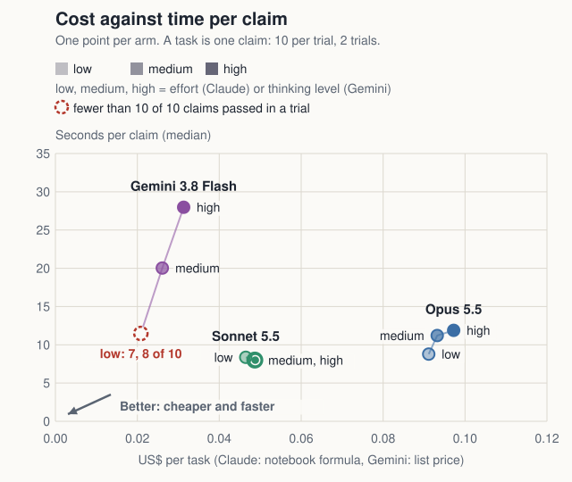
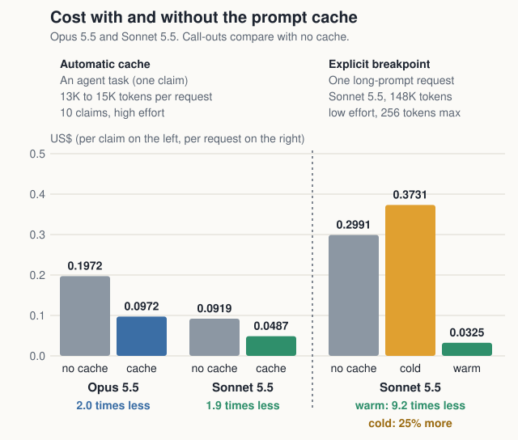
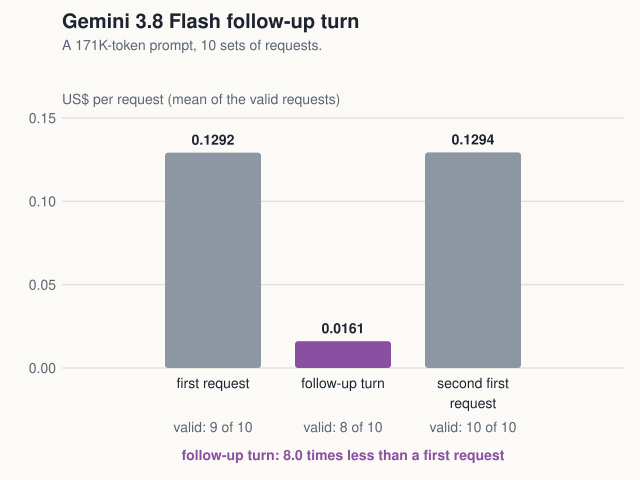

# Value map and cache savings

Navigation: [index](../../README.md) · [effort levels side by side](../consolidated/consolidated-results.md) · [Claude run 1 results](../run-1-results.md) · [Claude cache timing results](../cache-timing-results.md) · [Gemini 3.8 Flash results](../gemini-results.md) · [method](../method.md)

The value map and the cache savings, and the Gemini follow-up turn on its own. Everything is built from the records already published ([run 1](../../results/run1), [Gemini agent task](../../results/gemini-flash-loop), [Sonnet cache timing](../../results/cache-timing-sonnet) and [Gemini cache timing](../../results/gemini-flash-cache-timing)); nothing was run again. Fable 5.1 and the arms without a cache are in the [full table](../consolidated/results-table.md), not on the value map.

## Value map

**Sonnet 5.5 costs about half as much as Opus 5.5 ($0.0465 to $0.0488 against $0.0911 to $0.0972 per task) and is as fast or faster (8.0 to 8.4 s per claim against 8.8 to 11.9 s); Gemini 3.8 Flash is the cheapest ($0.0209 to $0.0313) and, level for level, the slowest (11.5 to 28.0 s), and at low thinking it failed the 10-of-10 bar (7 and 8 of 10).**

Settings: each point is one arm, 10 claims per trial and 2 trials per arm. Across is the mean cost per task of the two trials; up is the median, over the claims of both trials, of the seconds from a claim's first request to its verdict. Claude cost is by the notebook's formula and Gemini cost at Vertex list prices (global location), both from each request's usage block. The Claude arms use the automatic prompt cache; Gemini's cache is implicit and cannot be switched off. A lighter point is a lower effort (Claude) or thinking level (Gemini). Sonnet 5.5 at medium and high land on the same spot ($0.0001 apart in cost per task, 0.01 s in time per claim) and are drawn one inside the other. The two trials of one arm differ by up to 6.1% in cost per task and 26% in median time per claim, so small gaps between neighbouring points are not differences. Claude and Gemini ran on different APIs at different times, so read across the two families as approximate.

## Cache savings

**With the automatic cache an agent task costs about half: Opus 5.5 $0.1972 to $0.0972 (2.0 times less) and Sonnet 5.5 $0.0919 to $0.0487 (1.9 times less) per task. With an explicit cache breakpoint at the end of a shared 148K-token prompt, a warm Sonnet 5.5 request cost $0.0325 against $0.2991 with no cache (9.2 times less), and the first request, which writes the cache, cost $0.3731 (25% more than no cache).**

Settings: the agent task is 10 claims per trial and 2 trials per arm at high effort, with prompts of 13K to 15K tokens a turn; a task is one claim, the bar is the mean of the two trials, cost is by the notebook's formula and the cached arm uses the automatic prompt cache (what its cost is made of is in [the run 1 results](../run-1-results.md)). The long-prompt request is Sonnet 5.5 on a prefix of about 148,000 tokens (the system prompt, the tools and the claims ledger), 10 requests per state, a different question in each, one at a time, at low effort with tool choice none and at most 256 output tokens; each bar is the mean of the requests that passed their state check (10 of 10 in every state). Cold is the first request with a cache breakpoint, which writes the prefix; warm is a different question after the same prefix, which reads it. **The two panels switch the cache on in different ways.** In the agent task the automatic cache did not carry from one claim to the next: all 180 first turns of the cached arms wrote the prefix again and read nothing (see [how caching is switched](../how-caching-is-switched.md)), so the saving comes from the later turns of each claim. The long-prompt test puts an explicit breakpoint at the end of the shared prefix, which is what let a different question read it. The panels also differ in prompt size, effort and output, so the two ratios are not a like-for-like comparison of the two ways. Both panels share one dollar axis, but the left bars are cost per task (one claim) and the right bars cost per request. **Cost only:** warm was faster than no cache in 7 of 10 pairs, which the rule fixed before the run did not count as a time saving, and the agent task's median time per claim was 11.5 s without the cache and 11.9 s with it for Opus 5.5, and 8.8 s without the cache and 8.0 s with it for Sonnet 5.5, differences smaller than the 26% gap between the two trials of one of these arms.

## Gemini follow-up turn

**On a 171K-token prompt, a Gemini 3.8 Flash follow-up turn that hit the cache cost $0.0161 against $0.1292 for a first request (8.0 times less); 8 of the 10 follow-ups hit it.**

Settings: Gemini 3.8 Flash on Vertex AI, thinking at low, 10 sets of three requests on a prefix of about 171,000 tokens (the system prompt, the tools and the claims ledger). The first request has a fresh nonce; the follow-up turn is the first request, its reply and a new question; the second first request is a control of the same kind as the first. Each bar is the mean cost of the valid requests: a follow-up is valid when it read at least 92.9 percent of its prompt from the cache, and a first request when it read nothing from it. Gemini's cache is implicit and cannot be switched off, so there is no no-cache arm, and a first request is the case where nothing was cached. **What it does not show:** in the diagnostic, a new question sent as a separate request never hit the cache (see [the Gemini results](../gemini-results.md#what-the-diagnostic-found-about-the-cache)), and the time reading fixed before the run came out as not seen, so this chart is about cost only. These states do not map onto the Claude cold, warm and no-cache states and are not drawn on the same chart as them.

Built by `python3 build_blog_charts.py`.
