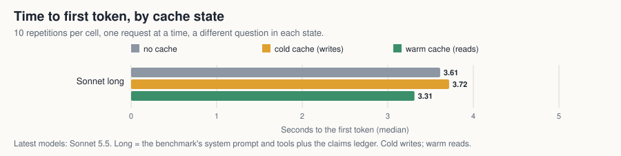
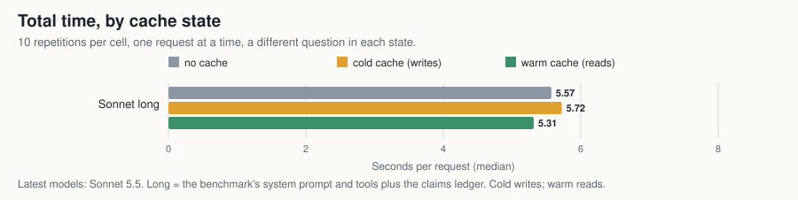
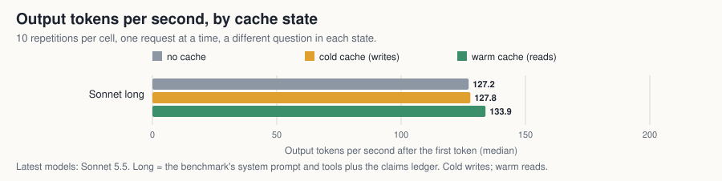

# Cache timing test, Sonnet (2026-10-22)

Is there a true time saving from the prompt cache? This is the first run of the [cache timing test](plan-next-runs.md) planned before any paid call: Sonnet 5.5 only, on the long prefix (the benchmark's system prompt and tools plus the claims ledger, 148,271 tokens by the [token counting endpoint](https://platform.claude.com/docs/en/build-with-claude/token-counting)), 10 repetitions of three requests (no cache, cold cache, warm cache), a different question in each request, one at a time. Opus and Fable have not been run.

Navigation: [index](../README.md) · [plan](plan-next-runs.md) · [how caching is switched](how-caching-is-switched.md) · [raw records](../results/cache-timing-sonnet) · [script](../cache_timing.py)

## Result

**On a 148,271-token prefix a warm Sonnet 5.5 request cost 9.2 times less than one with no cache ($0.0325 against $0.2991), but warm was faster in only 7 of 10 pairs, short of the 8 required, so a time saving is not established.**

- **The cache worked as designed, on every request.** All 30 requests passed their state check: cold wrote 148,132 tokens and read none, warm read 148,132 and wrote none, no cache did neither.
- **Cost: a clear saving.** A warm request cost $0.0325 against $0.2991 with no cache (9.2 times less); a cold request, which writes, cost $0.3731 (25 percent more than no cache).
- **Time: no saving seen under the rule fixed before the run.** The headline reading is warm against no cache, seen when warm was faster in at least 8 of 10 paired repetitions. Warm was faster in 7 of 10, so it is **not seen**. The median time to first token was 3.31 seconds warm, 3.61 with no cache and 3.72 cold; the median difference of warm against no cache is 0.49 seconds in warm's favour, inside the scatter described below. Cold against no cache (the cost of a write): cold was slower in 6 of 10, also not seen.
- **Output speed was the same in all three states** (127, 128 and 134 tokens per second; the largest difference, 5.1 percent, is inside the scatter of 19.9 tokens per second), so the negative control raised no flag: output speed did not change with the cache state.
- **The scatter is large and it has two modes.** 23 of the 30 requests took 3.3 to 5.1 seconds to the first token; 7 took 1.1 to 1.9 seconds: 3 no-cache requests, 4 warm ones and no cold ones. A fast reply with no cache shows that something other than the visible cache can make a request faster. I do not know what, and this run cannot say. That is why the median differences cannot be read as a saving or its absence.
- **What it means for the question, on this evidence:** for Sonnet 5.5 on a 148,000-token prefix, the cache saved money and no time was shown to be saved. Ten repetitions are too few to tell a small saving from this scatter. The plan's expectation that the long prefix is where a saving shows was not confirmed.
- **Against the plan's estimates:** the measured prefix, 148,271 tokens, was above the highest guess the plan gave (127,288); the Sonnet upper bound at that guess was $6.06 and the run cost $7.05; and the smoke set cost $0.70 against the "about $0.50" the plan expected. The plan's estimates were too low on all three counts.

## The table

| Model | Prefix | State | Checked ok | First token s (median, quartiles) | First event s (median) | Wall s (median) | Output tokens/s (median) | Connect s (median, not in the times) | $ per request |
|---|---|---|---|---|---|---|---|---|---|
| Sonnet | long | no cache | 10 of 10 | 3.61 (1.91 to 3.74) | 3.61 | 5.57 | 127.2 | 0.049 | 0.2991 |
| Sonnet | long | cold cache (writes) | 10 of 10 | 3.72 (3.46 to 4.08) | 3.72 | 5.72 | 127.8 | 0.047 | 0.3731 |
| Sonnet | long | warm cache (reads) | 10 of 10 | 3.31 (1.84 to 3.66) | 3.31 | 5.31 | 133.9 | 0.051 | 0.0325 |

Paired differences, per repetition, same model and prefix (negative = the second is faster):

| Model | Prefix | Pair | First token s, median difference | Repetitions where the second was faster | Wall s, median difference |
|---|---|---|---|---|---|
| Sonnet | long | cold cache to warm cache | -0.41 | 7 of 10 | -0.31 |
| Sonnet | long | no cache to warm cache | -0.49 | 7 of 10 | -0.52 |
| Sonnet | long | no cache to cold cache | +0.29 | 4 of 10 | +0.18 |

Reading rule (fixed before the run). Headline: warm against no cache; a saving is seen when warm was faster in at least 8 of the 10 paired repetitions. Stricter, secondary: warm also faster than cold in at least 8. Separately, the cost of writing: cold slower than no cache in at least 8.

| Model | Prefix | Headline: warm faster than no cache | Stricter: also faster than cold | Cold slower than no cache (the cost of a write) |
|---|---|---|---|---|
| Sonnet | long | not seen (7 of 10) | not seen (7 of 10) | not seen (6 of 10) |

Negative control: output tokens per second should not depend on the cache state, since a cache read skips reading the prompt and not generating tokens. The flag is raised only when the largest difference between the state medians is both more than 10 percent and larger than the widest scatter inside a state (its interquartile range), and the spread is printed beside it so a reader can see for themselves.

| Model | Prefix | Tokens/s: no cache, cold, warm | Largest relative difference | Widest within-state spread (interquartile range) | Flag |
|---|---|---|---|---|---|
| Sonnet | long | 127.2, 127.8, 133.9 | 5.1 percent | 19.9 tokens/s | none |

Longest wait between a cold request ending and its warm request starting: 0.0 s (the cache lives 5 minutes).

Requests that failed their state check (left out of the medians): 0 of 30.

Models: Opus 5.5, Sonnet 5.5, Fable 5.1, the latest versions. 13k = the benchmark's system prompt and tools, about 13,000 tokens; long = the same plus the claims ledger. no cache = none; cold = first request with a cache breakpoint, writes; warm = a different question after the same prefix, reads.

Three charts, from the same records: [time to first token](cache-timing-first-token.svg), [total time](cache-timing-wall.svg) and [output tokens per second](cache-timing-tps.svg), each by cache state.

## What was run, and what limits it

**The time reading rests on one model, one prefix and ten repetitions with a two-mode scatter (7 of 30 replies in 1.1 to 1.9 s, none of them a cold request), so it cannot separate a small saving from noise.**

- **Script and settings:** `cache_timing.py --live --only sonnet` at commit `ef85e77` (`cache_timing.py` sha256 prefix `a8547d47200ed4df`, `model_benchmark.py` `31269d971ca80ce3`; a later commit changed one comment in `cache_timing.py` that gave the order of the states the wrong way round). Effort low, 256 output tokens at most, tool choice none and thinking set to `between_tools`, which is how Sonnet 5.5 turns thinking off (it rejects `disabled`); no thinking tokens were produced. 28 of the 30 replies ran to the 256-token cap and two ended on their own (241 and 255 tokens), so output length is almost the same across states.
- **Clock:** started after the connection was open; the connection (DNS, TCP and TLS) took 47 to 51 milliseconds (median per state; 41 to 71 across all 30 requests) and is not in any time. The upload of the prompt (about 268,000 bytes) is inside the clock in all three states.
- **Order:** cold, warm, no cache in repetitions 1, 3, 5, 7 and 9, and no cache, cold, warm in repetitions 2, 4, 6, 8 and 10. The three fastest replies (1.1 to 1.4 seconds) were a no-cache request that came first in its set, a no-cache request that came last and a no-cache request that came first, so order does not explain them. The network interface stayed the same (`en0`) throughout and the separate TCP-only probe made before each set, which is not the connection used for the requests, took 18 to 32 milliseconds (first of its three samples).
- **Retries:** two warm requests (repetitions 2 and 10) needed a second attempt after a broken connection while sending the body; both then passed their state check. A request whose first attempt was lost may have been billed and is not counted.
- **Run:** 30 requests in 2.8 minutes, $7.05 by the notebook formula. A smoke test of one Sonnet set before it (3 requests, $0.70) is not in these records; its time to first token was 3.90 seconds cold, 4.77 warm and 1.31 with no cache, the same wide scatter. Two earlier attempts of the smoke test were rejected by the API before any request ran and cost nothing.
- **Not shown:** Opus and Fable; any prefix other than this one; the effect of load and time of day, which were not controlled.
