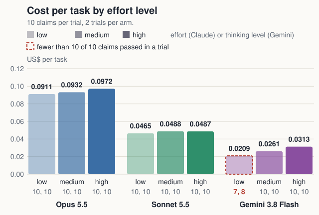
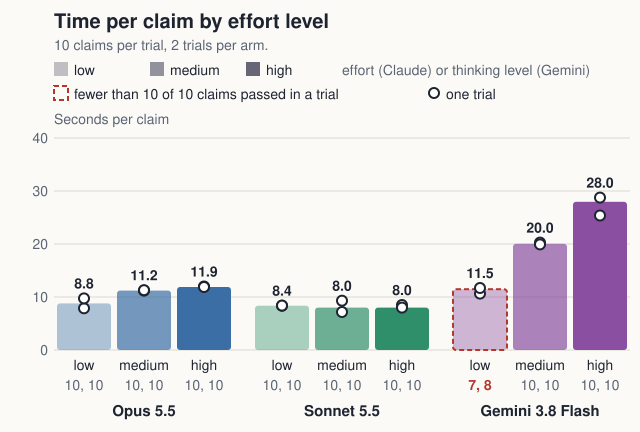

# Effort levels side by side

Navigation: [index](../../README.md) · [Claude run 1 results](../run-1-results.md) · [Gemini 3.8 Flash results](../gemini-results.md) · [method](../method.md)

**Effort barely moves Claude's cost (+5% to +7%, about the size of the run-to-run spread). On Gemini 3.8 Flash the effect is large: low fails the 10-of-10 bar (7 and 8 of 10), and high costs 50% more than low and takes 2.4 times as long per claim.**

Opus 5.5 and Sonnet 5.5 at low, medium and high effort with the automatic cache, and Gemini 3.8 Flash at low, medium and high thinking, from the records already published: [results/run1](../../results/run1) and [results/gemini-flash-loop](../../results/gemini-flash-loop). Nothing was run again. Every other arm passed 10 of 10 in both trials; Gemini 3.8 Flash at low passed 7 of 10 in trial 1 and 8 of 10 in trial 2. Fable 5.1 and the arms without a cache are in the full table at the end, not on the charts.

## Cost per task

**From low to high effort, cost per task changes by +7% for Opus 5.5 (0.0911 to 0.0972), +5% for Sonnet 5.5 (0.0465 to 0.0487) and +50% for Gemini 3.8 Flash (0.0209 to 0.0313).**

Settings: 10 claims per trial, 2 trials per arm; the bar is the mean of the two trials. Claude cost is by the notebook's formula and Gemini cost at Vertex list prices (global location), both from each request's usage block. The Claude arms use the automatic prompt cache; Gemini's cache is implicit and cannot be switched off. Under each bar: claims passed out of 10 in trial 1 and trial 2. Claude and Gemini ran on different APIs on different days, so read across the two families as approximate.

## Time per claim

**From low to high effort, the median time per claim goes from 8.8 s to 11.9 s for Opus 5.5, from 8.4 s to 8.0 s for Sonnet 5.5 and from 11.5 s to 28.0 s for Gemini 3.8 Flash.**

Settings: the bar is the median, over the claims of both trials, of the seconds from a claim's first request to its verdict; each dot is one trial's own median. Every request was streamed. Claude and Gemini ran on different APIs on different days, so read across the two families as approximate.

## Run-to-run spread

**The two trials of one arm differ by up to 6.1% in cost per task and 26% in median time per claim, so Opus 5.5's +7% and Sonnet 5.5's +5% in cost are about the size of that gap, while Gemini 3.8 Flash's +50% is 8 times it.**

With two trials per arm the gap between them is the only measure of spread the records give, so this is a rough guide and not a test.

## Every arm

| Arm | Trials | $ per task | Wall s per claim | Wall s per request | First event s, first / later turns | First content s, first / later turns | First text s, first / later turns |
|---|---|---|---|---|---|---|---|
| Opus high no cache | 10/10, 10/10 | 0.1972 | 11.53 | 2.95 | 1.87 / 1.76 | 2.02 / 2.54 | 1.66 / 3.21 |
| Opus high cache | 10/10, 10/10 | 0.0972 | 11.89 | 3.05 | 1.79 / 1.72 | 1.91 / 2.70 | n/a / n/a |
| Opus medium cache | 10/10, 10/10 | 0.0932 | 11.21 | 2.87 | 1.99 / 1.71 | 1.99 / 2.45 | n/a / n/a |
| Opus low cache | 10/10, 10/10 | 0.0911 | 8.79 | 2.46 | 1.61 / 1.67 | 1.61 / 1.95 | n/a / 1.94 |
| Sonnet high no cache | 10/10, 10/10 | 0.0919 | 8.80 | 2.30 | 1.51 / 1.47 | 1.51 / 2.24 | n/a / 4.67 |
| Sonnet high cache | 10/10, 10/10 | 0.0487 | 8.00 | 2.27 | 1.53 / 1.44 | 1.53 / 2.13 | n/a / 2.33 |
| Sonnet medium cache | 10/10, 10/10 | 0.0488 | 8.00 | 2.20 | 1.49 / 1.48 | 1.49 / 1.98 | n/a / 1.48 |
| Sonnet low cache | 10/10, 10/10 | 0.0465 | 8.37 | 2.34 | 1.61 / 1.43 | 1.61 / 2.05 | n/a / 2.07 |
| Fable high no cache | 10/10, 10/10 | 0.5329 | 17.12 | 3.28 | 0.82 / 0.88 | 1.36 / 3.17 | 1.36 / 1.64 |
| Fable high cache | 10/10, 10/10 | 0.2720 | 19.20 | 5.22 | 1.07 / 1.12 | 1.70 / 5.67 | 1.70 / 3.10 |
| Fable medium cache | 10/10, 10/10 | 0.2628 | 15.86 | 3.24 | 0.87 / 1.05 | 1.54 / 3.58 | 1.54 / n/a |
| Fable low cache | 10/10, 10/10 | 0.2501 | 12.96 | 2.95 | 0.89 / 1.03 | 0.89 / 2.95 | 0.89 / 2.40 |
| Gemini 3.8 Flash high | 10/10, 10/10 | 0.0313 | 27.97 | 4.20 | 3.64 / 5.40 | 3.64 / 5.40 | n/a / n/a |
| Gemini 3.8 Flash medium | 10/10, 10/10 | 0.0261 | 20.04 | 3.44 | 2.88 / 4.47 | 2.88 / 4.47 | n/a / n/a |
| Gemini 3.8 Flash low | 7/10, 8/10 | 0.0209 | 11.48 | 1.85 | 1.97 / 1.70 | 1.97 / 1.70 | n/a / n/a |

Models: Opus 5.5, Sonnet 5.5, Fable 5.1 (latest on 2026-10-22). high, medium, low = effort level. cache = automatic prompt cache; no cache = none. Gemini arms: high, medium, low = thinking level. The Gemini cache is implicit, on for every project and not switchable by a user, so there is no no-cache arm; the cached share is what the usage block reported. Times are medians over all requests of the arm; wall time per claim runs from a claim's first request to its verdict.

Built by `python3 build_results_table.py --consolidated results/run1 results/gemini-flash-loop`.
