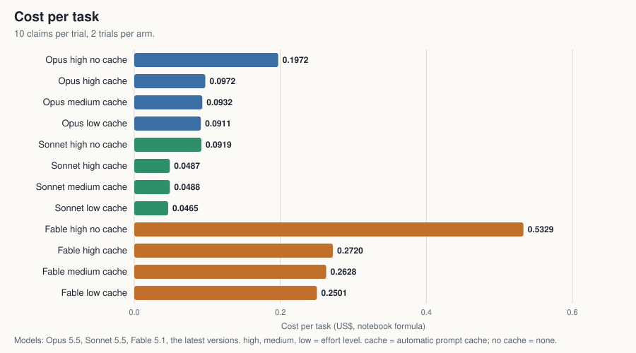
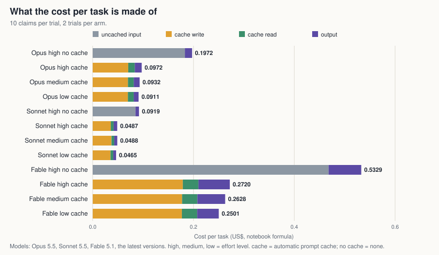
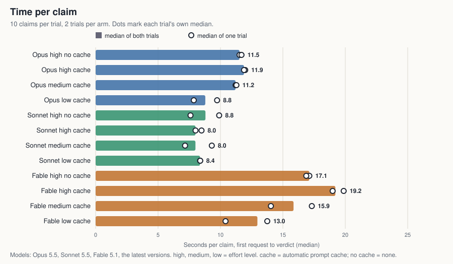
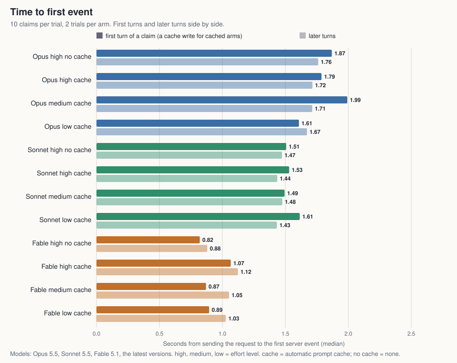

# Run 1 results (2026-10-22)

The task is the claims agent from the cost-optimization notebook in Anthropic's cookbook (`cost_optimization/cost_optimization.ipynb`): ten fictional insurance claims, twelve local tools, at most six turns per claim. Run 1 measured cost and time per task for 12 model and setting combinations: 2 trials of the 10 claims each, streamed, in a rotated arm order. It follows the [run 1 plan](run-1-plan.md), which was committed before the run. The notebook's arm with an explicit system breakpoint was not run.

Navigation: [index](../README.md) · [method](method.md) · [how caching is switched](how-caching-is-switched.md) · [raw records](../results/run1) · [table and chart builder](../build_results_table.py)

## Result

All 12 arms passed 10 of 10 claims in both trials: 24 of 24 trials, 240 adjudications. **No arm is separated on quality**, so the differences below are cost and time. Ten claims did not separate the arms; the notebook itself says to use about 50 cases and at least 5 trials before a production decision.

- **Caching about halves the cost on all three models.** No cache against cache, both at high effort: Opus $0.1972 to $0.0972 (2.0 times), Sonnet $0.0919 to $0.0487 (1.9 times), Fable $0.5329 to $0.2720 (2.0 times).
- **In the cached arms the cache write is the largest part of the cost.** The [cost breakdown chart](cost-breakdown.svg) splits each arm's cost into uncached input, cache write, cache read and output. With cache, the write is 66 to 77 percent of the cost and the read only 11 to 13 percent, because the first turn of every claim writes the whole prefix again (see [how caching is switched](how-caching-is-switched.md)). Without cache, uncached input is 88 to 93 percent.
- **Effort moves cost less than caching does.** High against low effort with cache: Opus $0.0972 to $0.0911 (6 percent lower), Sonnet $0.0487 to $0.0465 (5 percent), Fable $0.2720 to $0.2501 (8 percent). With two trials these are small differences, and the Opus and Sonnet ones are within the spread.
- **Effort and quality, Sonnet with cache:** 2 of 2 trials perfect at each of high, medium and low effort. These runs show no drop with lower effort. These are counts, with no claim about why.
- **Time per claim, median over both trials:** Sonnet 8.0 to 8.8 seconds; Opus 11.2 to 11.9 seconds at high and medium effort and 8.8 at low effort; Fable 13.0 to 19.2 seconds. Fable's first event arrives sooner than the others (0.8 to 1.1 seconds against 1.4 to 2.0), but its claims take longer.
- **Low effort gave shorter claims on Opus and Fable, not on Sonnet.** With cache, Opus went from 11.9 to 8.8 seconds (26 percent shorter, inside the trial spread described below) and Fable from 19.2 to 13.0 (32 percent shorter, just outside it). Sonnet went from 8.0 to 8.4.
- **The cache did not shorten the claims.** High effort, no cache against cache: Opus 11.5 and 11.9 seconds, Sonnet 8.8 and 8.0, Fable 17.1 and 19.2. At this prefix size of about 13,000 tokens the cache cut cost and not time, within the spread below.
- **A cache write on a claim's first turn did not delay the first event** measurably: first event for first turns against later turns is 1.87 and 1.76 seconds for Opus with no cache and 1.79 and 1.72 with it, and similar on the other arms.

## The table

One row per arm. Pass counts are per trial, 10 claims each. Cost per task is by the notebook's formula. Times are in seconds; the first-token columns are medians for the first turn of a claim and for later turns, separately, because the first turn of every claim pays the cache write. [arms.json](../arms.json) holds the arm labels, and `python3 build_results_table.py results/run1` rebuilds this table and the four charts.

| Arm | Trials | $ per task | Wall s per claim | Wall s per request | First event s, first / later turns | First content s, first / later turns | First text s, first / later turns |
|---|---|---|---|---|---|---|---|
| Opus high no cache | 10/10, 10/10 | 0.1972 | 11.53 | 2.95 | 1.87 / 1.76 | 2.02 / 2.54 | 1.66 / 3.21 |
| Opus high cache | 10/10, 10/10 | 0.0972 | 11.89 | 3.05 | 1.79 / 1.72 | 1.91 / 2.70 | n/a / n/a |
| Opus medium cache | 10/10, 10/10 | 0.0932 | 11.21 | 2.87 | 1.99 / 1.71 | 1.99 / 2.45 | n/a / n/a |
| Opus low cache | 10/10, 10/10 | 0.0911 | 8.79 | 2.46 | 1.61 / 1.67 | 1.61 / 1.95 | n/a / 1.94 |
| Sonnet high no cache | 10/10, 10/10 | 0.0919 | 8.80 | 2.30 | 1.51 / 1.47 | 1.51 / 2.24 | n/a / 4.67 |
| Sonnet high cache | 10/10, 10/10 | 0.0487 | 8.00 | 2.27 | 1.53 / 1.44 | 1.53 / 2.13 | n/a / 2.33 |
| Sonnet medium cache | 10/10, 10/10 | 0.0488 | 8.00 | 2.20 | 1.49 / 1.48 | 1.49 / 1.98 | n/a / 1.48 |
| Sonnet low cache | 10/10, 10/10 | 0.0465 | 8.37 | 2.34 | 1.61 / 1.43 | 1.61 / 2.05 | n/a / 2.07 |
| Fable high no cache | 10/10, 10/10 | 0.5329 | 17.12 | 3.28 | 0.82 / 0.88 | 1.36 / 3.17 | 1.36 / 1.64 |
| Fable high cache | 10/10, 10/10 | 0.2720 | 19.20 | 5.22 | 1.07 / 1.12 | 1.70 / 5.67 | 1.70 / 3.10 |
| Fable medium cache | 10/10, 10/10 | 0.2628 | 15.86 | 3.24 | 0.87 / 1.05 | 1.54 / 3.58 | 1.54 / n/a |
| Fable low cache | 10/10, 10/10 | 0.2501 | 12.96 | 2.95 | 0.89 / 1.03 | 0.89 / 2.95 | 0.89 / 2.40 |

Models: Opus 5.5, Sonnet 5.5, Fable 5.1, the latest versions. high, medium, low = effort level. cache = automatic prompt cache; no cache = none. Times are medians over all requests of the arm; wall time per claim runs from a claim's first request to its verdict.

How to read the timing columns:

- **Wall s per claim:** from the first request of a claim to its verdict, including local tool time.
- **Wall s per request:** from just before the request is opened to the end of the stream.
- **First event:** the first server event. **First content:** the first thinking, text or tool-input delta. **First text:** the first text delta, which only replies with text have. Most turns end in a tool call with no text: only 105 of 772 requests had any, so "n/a" is common in the first-text columns and the medians that do show rest on a few requests.

## The charts

[Cost per task](cost-per-task.svg): the table's cost column as bars.

[What the cost is made of](cost-breakdown.svg): uncached input, cache write, cache read and output, by the notebook's multipliers. The four parts add up to the recorded cost of every request.

[Time per claim](time-per-claim.svg): median seconds, with the median of each trial marked so the spread shows.

[Time to first event](time-to-first-event.svg): first turns and later turns side by side.

Models: Opus 5.5, Sonnet 5.5, Fable 5.1, the latest versions. high, medium, low = effort level. cache = automatic prompt cache; no cache = none.

## How much to trust the differences

- **Two trials per arm.** For each arm the median claim time differed between its two trials by up to 30 percent (ratio of trial 2 to trial 1 between 0.76 and 1.30), so timing differences smaller than about 30 percent between close arms are not separable here. Fable against Sonnet is far outside that. The effort effect on time is plausible; confirming it needs more trials.
- **Cost per task between trials** differed by up to 10 percent on the no-cache arms (Opus with no cache $0.2065 and $0.1878) and under 6 percent on the cached ones. The cost differences between effort levels are of that size.
- **Order and time of day.** The run took 66 minutes. The arm order was rotated by half the list in trial 2, which spreads time-of-day effects over the arms and does not remove them. The network and API load were not measured.
- **Network.** The person running it recalls switching the machine's network between Wi-Fi and mobile during the run, at a time that was not recorded. That may explain the one timeout below. It is a recollection, and nothing in the records shows it.
- **Retries.** All 772 requests ended with status 200. Two took a second attempt: a request on Sonnet at medium effort with cache (a timeout) and one on Fable at low effort with cache (a connection error). Medians are used because the failed attempt's wait is inside that claim's wall time, and one trial's total wall time of 998 seconds is that timeout. A request whose reply was lost may have been billed and is not counted.
- **Connection setup is inside the times.** Each request opened a new connection and the clock started before it was made, so every time to first event, first token and total time in this report includes DNS, TCP and TLS setup, which varies from request to request (typically tens to a few hundred milliseconds). Later runs make the connection first and keep it out of the clock.
- **Cached against uncached first-token times** are comparable only where the cache is warm. The first turn of every claim is cold in every cached arm, which is why first turns and later turns are shown apart.

## Spend and records

772 requests, 24 trials, three model ids from the API's own replies (`claude-opus-5-5` 261 requests, `claude-sonnet-5-5` 247, `claude-fable-5-1` 264). $40.65 by the notebook formula and $38.92 at list price, against an estimate of $41.38 made before the run. One further streamed smoke test (one claim of Sonnet low cache, 3 requests, $0.04) ran first and is not in these records. The run used the script at commit `33619ba` (`model_benchmark.py`, sha256 prefix `8cc56e8fff643608`); later commits changed comments, the name of the default arm list and the arm labels, and, for later runs, how `--stream` makes its connection and starts its clock (see the connection-setup note above). The raw records are in [results/run1](../results/run1) and are unedited.
